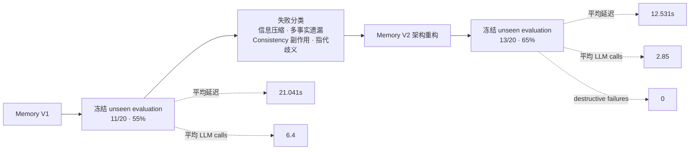

# Personalized Conversational Agent

一个本地运行的个性化对话 Agent，具备联系人级长期记忆、Working Memory、语义检索和风格感知回复生成能力。

> **项目状态：** 已冻结的研究原型。仓库同时记录有效改进和未解决的失败模式，不将其描述为生产就绪系统。

## 1. 项目概览

本项目研究一个对话 Agent 如何面向多个联系人生成不同回复，同时严格隔离各联系人的记忆。系统包含：

- sender-scoped Working Memory 与 Long-Term Memory；
- 多语言 embedding 语义检索；
- 基于 LLM 的相关性过滤、回复规划、草稿生成和风格改写；
- 结构化决策后的确定性 Memory CRUD；
- accept / edit / reject 人工反馈；
- Memory V1 与 V2 的冻结 unseen evaluation；
- Generic、Memory-only、Full 三组个性化消融实验。

系统坚持 local-first。文本生成使用 Ollama 与 `qwen2.5:7b-instruct`，语义检索通过 SentenceTransformers 使用 `paraphrase-multilingual-MiniLM-L12-v2`。

## 2. 为什么做这个项目

一个有用的个人 Agent 不能只保存聊天记录。它还需要判断哪些事实仍然有效、避免混淆联系人、只检索当前相关的信息，并在不改变事实和意图的前提下贴近用户自己的表达方式。

因此，项目将问题拆成几个独立研究问题：

1. 记忆生命周期操作能否泛化到真正未见过的消息？
2. 破坏性操作能否保持保守，并严格限制在单个 sender namespace？
3. 联系人上下文是否能让回复优于普通 LLM baseline？
4. Style Rewrite 能否提升表达，同时保持事实和意图？
5. 每一层能力分别增加多少延迟和 LLM 调用？

## 3. 系统架构

### Agent Pipeline 与 Memory V2 内部流程

```mermaid
flowchart LR
    A[联系人消息] --> B[Sender Identification]
    B --> C[联系人级 Working Memory]
    C --> D[Context Resolution]
    D --> E[Memory V2]
    E --> F[相关 Long-Term Memory]
    F --> G[Response Planner]
    G --> H[Draft Generator]
    H --> I[联系人级 Style Retrieval]
    I --> J[Style Rewriter]
    J --> K[最终回复]
    K --> L[人工 accept / edit / reject]

    subgraph M2[Memory V2 生命周期]
        M1[Message + Working Memory] --> M3[Atomic Fact Extractor]
        M3 --> M4[Fact-specific Retrieval]
        M4 --> M5[Fact Alignment]
        M5 --> M6[NEW / DUPLICATE / UPDATE / DELETE / AMBIGUOUS]
        M6 --> M7[Schema 与 Evidence Validation]
        M7 --> M8[Deterministic CRUD]
        M8 --> M9[Restricted Consistency]
    end

    E -. 内部展开 .-> M1
    M8 --> S[(联系人级 Long-Term Memory)]
    S --> F
```



`memory_v2.py` 是独立冻结并完成评估的记忆生命周期重构。冻结实验阶段没有将它接入交互主路径；Agent V3 现已支持通过 `main.process_user_message(..., memory_version="v2")` 显式选择 V2。默认调用和现有 CLI 继续使用 V1，独立 V2 入口仍保留。下文实验结果来自原冻结评测，并未因本次集成重新生成。

### 实验演化



## 4. Memory V2

Memory V1 让单个 Memory Manager 同时承担多项职责。它能处理许多直接场景，但容易压缩多事实消息、生成自由文本 target，并赋予 Consistency 过大的修改权限。

Memory V2 将推理单位从整条消息改为 atomic fact：

- **Atomic Fact Extractor：** 拆分持久事实、状态变化、瞬时信息和歧义指代。
- **Fact-specific Retrieval：** 为每个持久事实独立检索候选。
- **Fact Alignment：** 从候选 index 中选择目标，并返回分类决策，不再自由生成 target 字符串。
- **保守验证：** 拒绝证据不足的写入和破坏性操作。
- **Deterministic CRUD：** 只在当前 sender namespace 内执行已验证动作。
- **Restricted Consistency：** 缺少依赖来源信息时，不执行次级破坏性修改。
- **Ambiguity Abstention：** 无法可靠区分目标时停止写入，而不是猜测。

V2 提升了 unseen 泛化和安全性，但其冻结 final pass rate 仍为 65%，不是 100%。

## 5. 个性化回复流程

回复生成将内容和风格分离：

1. 使用联系人级 Working Memory 解析当前指代。
2. 检索并过滤相关 Long-Term Memory。
3. 生成结构化回复计划：`intent`、`points`、`tone`。
4. 根据计划与事实上下文生成中性 Draft。
5. 仅在相同 sender 的历史样本中检索 Style Samples。
6. 在保持 Draft 事实和意图的前提下改写表达。
7. 由人工 accept、edit 或 reject；真实结果写入 feedback 和 Working Memory。

Style Memory 与事实型 Long-Term Memory 独立存储。Style Retrieval 使用历史 `incoming` 与当前消息计算相似度，再取对应历史回复作为表达参考。

## 6. 评估方法

项目没有将所有指标压缩成一个总分，而是使用互相独立的评估产物：

- **Memory V1 Final：** 20 条冻结的 sender-aware unseen integration cases。
- **Memory V2 Final：** 20 条全新的冻结 unseen cases，分别记录 behavior、destructive failure、error 和 sender pollution。
- **Personalization Development Set：** 15 条 synthetic cases，覆盖目标、偏好、状态更新、sender isolation、情绪消息、建议、知识问题、Working Memory 指代和 style mismatch。
- **消融实验：** Generic vs Memory-only vs Full，三组使用相同本地文本模型和确定性生成配置。
- **人工盲评：** 将 Memory-only 与 Full 随机分配为 A/B；reviewer 能看到当前上下文、synthetic 联系人背景和 synthetic Style Samples，但看不到模式标签。

开发阶段的自动个性化 Judge 退化为重复的模板式判断，因此其表面上的 100% factual/semantic 分数不作为有效证据。下方人工盲评结果独立报告，并严格限定为：**15 条 synthetic development cases、单个 reviewer**。

## 7. 实验结果

### Memory V1 vs Memory V2

| 指标 | Memory V1 | Memory V2 |
|---|---:|---:|
| Frozen unseen 通过数 | 11/20 | 13/20 |
| Pass rate | 55% | 65% |
| Behavior failures | 9 | 7 |
| Destructive failures | 未独立分类 | 0 |
| Cross-sender pollution | 0 | 0 |
| 平均延迟 | 21.041s | 12.531s |
| 平均 LLM calls | 6.4 | 2.85 |

相比 V1，V2 的 unseen pass rate 提升 10 个百分点，平均延迟降低 40.4%，平均 LLM 调用减少 55.5%，且没有记录到 destructive failure。

### Generic vs Memory-only vs Full

| 指标 | Generic | Memory-only | Full |
|---|---:|---:|---:|
| 平均 Agent 延迟 | 3.969s | 10.854s | 14.692s |
| 平均 LLM calls | 1.00 | 3.07 | 4.07 |
| Cross-sender leakage | 0 | 0 | 0 |
| Unsupported personalization | 0 | 0 | 0 |

这些数字来自 15 条 synthetic development cases。由于自动 Judge 输出发生退化，其 factual pass rate 已被弃用。

### 人工盲评：Full vs Memory-only

| 问题 | Full | Memory-only | Tie |
|---|---:|---:|---:|
| Reviewer 更愿意发送 | 9 | 0 | 6 |
| 更符合 Style Samples | 3 | 0 | 12 |
| 更好保持原意 | 3 | 1 | 11 |
| 更自然 | 3 | 0 | 12 |

**适用范围：** 15 条 synthetic development cases、单个 reviewer。该结果只描述本 development set，不能外推为普遍人类偏好结论。

## 8. 失败分析

### Memory V1

- **信息压缩：** 单次 action 决策可能丢失约束或合并独立事实。
- **多事实拆分不足：** 混合 ADD / UPDATE / DELETE / transient 消息无法稳定覆盖。
- **Consistency 破坏性副作用：** 语义相关不足以证明记忆之间存在依赖关系。
- **歧义指代：** 自由文本 target 和模糊指代可能选错 memory，或无法完成解析。

### Memory V2 的改进

- 使用 atomic fact extraction，避免整句压缩；
- 每个 fact 独立检索；
- 使用 candidate index alignment，替代自由 target 字符串；
- Schema/Evidence 验证后才执行确定性 CRUD；
- 歧义时 abstain；
- 没有依赖证据时限制 Consistency 权限。

### 尚未解决的问题

V2 final 仍失败 7/20。已观察到的类型包括：保守弃权、错误 Duplicate、不完整状态迁移、fact extraction 遗漏，以及严格断言边界。在 personalization development 中，部分 case 没有检索到相关上下文；一个 Draft 过度使用了真实但无关的记忆；一个 Full 回复逐字复制了短 Style Sample。因此 Style Rewrite 可能提高可发送性，但仍需要语义保持和复制检测。

## 9. Demo

运行简洁本地界面：

```bash
python demo_cli.py
```

CLI 会依次要求输入 `sender_id` 和联系人消息，显示最终回复，然后接受 `accept`、`edit` 或 `reject`。接受和编辑结果会通过现有公共函数更新 feedback 与 sender-specific Working Memory。

使用 debug 模式查看检索记忆、当前 Working Memory、Planner 输出、Draft、Style Samples 和既有 timing diagnostics：

```bash
python demo_cli.py --debug
```

该 wrapper 默认隐藏内部详细日志，不包含重复 Prompt 或业务规则。

从项目目录、在安装依赖的环境中，通过 Python 显式使用 V2：

```python
from main import process_user_message

result = process_user_message("v3_demo", "我喜欢摄影", memory_version="v2")
print(result["personalized_reply"])
print(result["memory_v2_details"]["action_results"])
```

`memory_version` 只接受 `"v1"` 或 `"v2"`，非法值在 LLM 调用和 Memory 写入之前抛出 `ValueError`。两种版本均先生成回复，再运行且只运行一套 Memory 生命周期，最后等待人工反馈；`finalize_response()` 的 accept/edit/reject 使用方式不变。

默认 V1 保留原有全部返回字段。显式 V2 保留回复及 `timing_profile` 字段，并增加 `memory_version="v2"` 和原生的 `memory_v2_details`。V2 的 `processed_actions`、`action_results`、facts、alignment、coverage 和一致性说明均从该独立字段读取，不提供含义不同的顶层 V1 Memory 结果字段。V2 alignment 的 `target_index` 只引用对应 fact 的候选，不引用顶层 `relevant_memories`；V2 一致性说明也不是实际次级 CRUD 结果。

整轮调用只由主入口重置和汇总计时。V2 异常原样向上抛出，不自动回退 V1，也不回滚此前成功的写入；调用方不能把失败请求当作完全未发生写入。当前集成通过 Mock 推理和临时数据文件验证，尚未完成真实 Ollama 端到端验证。

重复执行基线和集成测试：`./run_baseline_tests.ps1`。该脚本使用项目专用解释器，测试中的真实 CRUD 和反馈写入仅发生在临时目录。

## 10. 项目结构

```text
memory-agent/
├── demo_cli.py                         # 薄交互入口
├── main.py                             # 个性化回复编排与反馈
├── memory_v2.py                        # 冻结的 atomic-fact memory lifecycle
├── memory_search.py                    # sender-scoped 存储与 embedding 检索
├── ollama_client.py                    # Ollama 调用、Prompt、校验与 profiling
├── working_memory.py                   # 联系人级短期对话状态
├── style_memory.py                     # 独立 sender-scoped Style Retrieval
├── feedback_store.py                   # accept/edit/reject 持久化
├── memories.json                       # sender-keyed 事实记忆
├── style_samples.json                  # Style Memory 样本
├── feedback.json                       # 人工反馈记录
├── final_memory_eval.py                # 冻结的 Memory V1 unseen benchmark
├── final_memory_v2_eval.py             # 冻结的 Memory V2 unseen benchmark
├── personalization_eval.py             # 三模式 development evaluation
├── personalization_dev_cases.json      # synthetic personalization cases
├── personalization_*_blind_*.json      # 盲评文件与独立 key
├── PROJECT_FACTS.md                     # 面试/简历事实清单
└── requirements.txt
```

## 11. 运行方式

本项目收尾时在 Python 3.10.8 与 Ollama 0.34.4 环境完成验证。

创建虚拟环境：

```bash
python -m venv .venv
```

激活环境后安装依赖：

```bash
pip install -r requirements.txt
```

安装并启动 Ollama，然后拉取项目配置的模型：

```bash
ollama serve
ollama pull qwen2.5:7b-instruct
```

在另一个终端启动 Demo：

```bash
python demo_cli.py
```

SentenceTransformers 第一次运行时可能下载 `paraphrase-multilingual-MiniLM-L12-v2`；离线运行前需要确保模型已经缓存。即使数据为空，三个 JSON 数据文件也必须保持合法的 JSON list/object 格式。

## 12. 关键设计决策

- **Sender ID 就是 namespace：** Memory 文本只写“联系人”，不重复联系人名字。
- **Style 与事实分离：** Style similarity 不能成为事实检索证据。
- **校验结构化 LLM 输出：** JSON 或字段非法时明确失败，不静默修改 memory。
- **破坏性操作只能选 index：** UPDATE / DELETE 只能选择已检索候选。
- **歧义优先 abstain：** 漏写比破坏无关状态更安全。
- **CRUD 确定执行：** 模型提出动作，应用代码负责校验和执行。
- **Consistency 权限受限：** 字符串存储缺少允许级联删除所需的 provenance。
- **本地模型选择来自实验：** Qwen3-VL 8B 系列出现严重随机延迟尖峰；pure-text Qwen2.5 7B control benchmark 15/15 返回合法 JSON，且没有一次超过十秒。
- **人工确认闭环：** 系统记录 accept、edit 和 reject，而不是把所有生成回复当作正确结果。

## 13. 已知限制

- Memory V2 的 frozen unseen pass rate 为 65%。
- 存储层使用 JSON，Working Memory 位于进程内，不支持事务或多进程协调。
- 字符串记忆没有 provenance 或依赖图。
- 交互 `main.py` 默认使用 V1 lifecycle，可显式选择 V2；现有 CLI 默认仍为 V1，真实 Ollama 的 V3 集成端到端尚未验证。
- 个性化评估使用 synthetic personas 和单个 reviewer。
- 自动 LLM Judge 输出退化，不能支撑 factual-rate 结论。
- Style embedding 只是表达相似度 proxy，不代表人工偏好。
- Style Rewrite 在 development set 中平均增加约 3.8 秒和一次 LLM 调用。
- Style Rewrite 可能复制样本短语或删除内容，不能保证语义保持。
- 项目不包含认证、加密、数据库迁移、Web UI 或部署层。

## 14. 后续方向

- 为显式 V2 主路径增加独立的真实 LLM 端到端评估，不改写冻结评测结果；
- 引入 provenance 与显式依赖元数据后，再考虑 Consistency 级联操作；
- 用经过独立验证的 categorical evaluation 替换失败的自动 Judge；
- 将盲评扩展到多个 reviewer 和获得授权/匿名化的场景；
- 将个性化质量、事实正确性和 latency 分开度量；
- 只有在 memory semantics 稳定后才引入持久化数据库。

